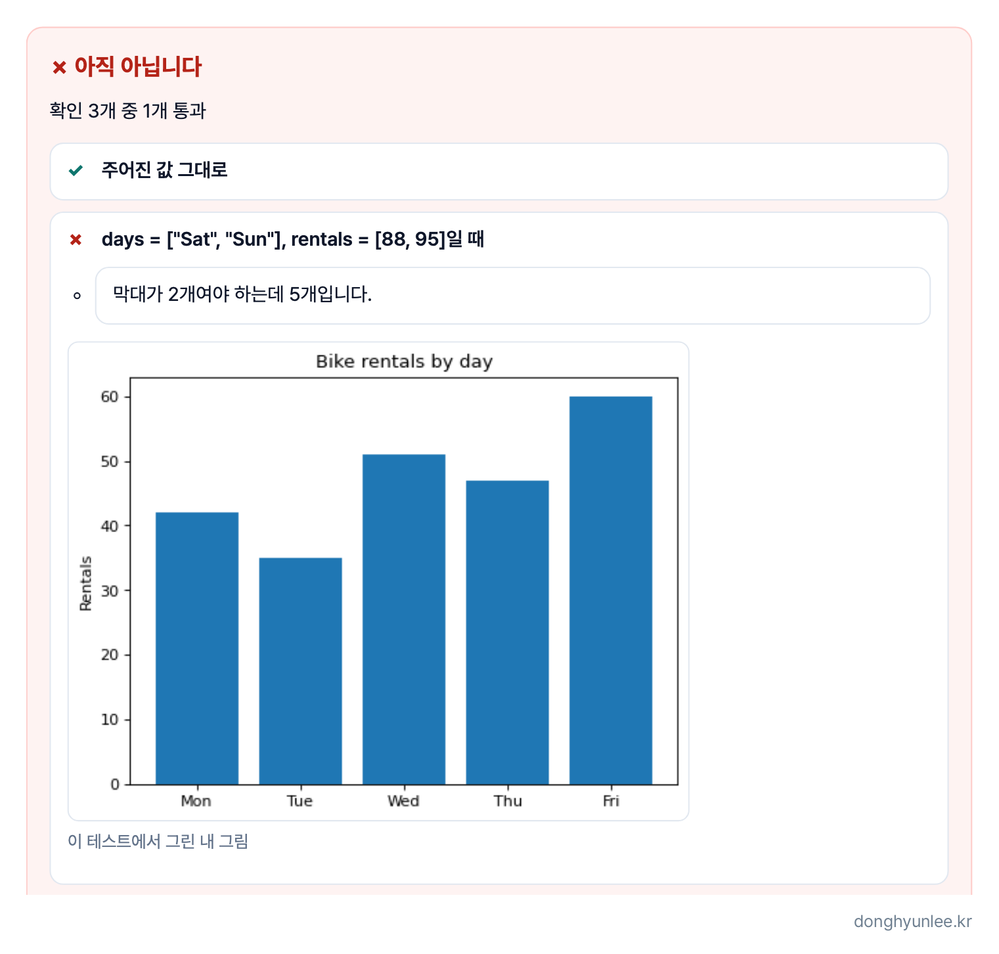

공부한 내용을 가장 빨리 확인하는 방법은 시간을 정해 두고 풀어서 채점을 받는 것이다. 그래서 학생들과 책을 산 독자가 스스로 확인할 수 있는 파이썬 코딩 테스트 연습 사이트를 만들었다. 배운 것이 손에 익었는지, 지금 잘 공부하고 있는지 보는 곳이다.

주소는 [donghyunlee.kr/practice](https://donghyunlee.kr/practice/)다. 수업 시간에 문제은행으로 타임어택을 하던 HTML 파일에서 시작해 10월 13일에 열었다. 파이썬 기본기 258문제, 데이터 시각화 135문제, 코딩 테스트 80문제, 이렇게 세 과목이 있다. 기본기와 시각화 문제는 내가 쓴 책의 장과 절을 따른다. 책을 읽고 장마다 배운 내용을 확인해 볼 수 있다. 출력을 예측하거나 빈칸을 채우는 문제, 코드를 쓰거나 틀린 코드를 고치는 문제가 있다. 로그인 없이 브라우저 안에서 파이썬이 돌고 바로 채점한다.

## 그래프를 채점하는 연습장

특히 구현에서 까다로웠던 곳은 시각화 과목이다. 그래프 코드를 쓰고 채점을 누르면 목표 그림과 비교해 어디가 다른지 바로 알려 준다. 그래프 코드를 확인해 주는 곳은 있다. 하지만 목표 그림의 값과 비교하고, 값을 바꿔 다시 그려 보는 연습 사이트는 나는 보지 못했다. 구현할 수 있어서 다행이었다.

같은 그림도 여러 코드로 그릴 수 있어 그래프 채점이 쉽지 않다. `plt`로 그려도, `fig, ax`로 그려도, pandas나 seaborn으로 그려도 그림은 같다. 그래서 그림을 픽셀로 비교하지 않는다. 학생이 그린 그림을 matplotlib 객체로 읽는다. 여기서 막대의 개수와 높이, 제목과 축 라벨 같은 값을 꺼내 목표 그림의 값과 비교한다. 목표 그림은 문제 화면에 함께 보인다. Plotly 그림은 Figure 객체를 읽는다. Streamlit 앱은 채점기 안에서 실행한 뒤 화면에 나온 것을 비교한다.

요일별 자전거 대여 건수를 막대 그래프로 그리는 문제가 있다. 변수 `days`와 `rentals` 대신 요일 다섯 개와 숫자 다섯 개를 코드에 그대로 적었다고 하자. 주어진 값으로 그린 그림은 목표 그림과 똑같다. 채점기는 거기서 멈추지 않고 값을 바꿔 두 번 더 그린다. 하나는 주말 이틀만 넣은 값이고, 다른 하나는 대여가 0인 요일이 있는 주다. 값을 외워 적은 코드는 여기서 떨어진다. 막대가 2개여야 하는데 5개라고, 월요일 막대는 10이어야 하는데 42라고 알려 준다. 외울 것은 값이 아니라 `ax.bar(days, rentals)`라는 코드 형태다.

_그림 1. 값을 외워 적은 코드는 주어진 값에서만 통과한다_

## 제한 시간을 둔 연습

기본기와 시각화 과목에는 타임어택이 있다. 범위와 문제 수, 제한 시간을 골라 시작하고, 문제마다 한 번만 제출할 수 있다. 시간은 1분부터 30분 사이에서 고르거나 제한 없이 둔다. 그래프 문제는 시간이 더 든다. 그래서 시각화는 5문제 20분이 기본값이다. 끝나면 그래프 문제마다 목표 그림과 틀린 이유를 함께 보여 준다. 코딩 테스트 과목에서는 모의 시험을 볼 수 있다. 시간은 40분, 60분, 120분 중에서 고르거나 제한 없이 둔다.

나는 시간을 정해 두고 풀면 그냥 공부할 때보다 실력이 훨씬 많이 는다고 본다. 그 이유는 암기와 응용에 있다. 코드에도 어느 정도 암기가 필요하다. 함수 이름과 인자, 그리는 순서가 머리에 있어야 손이 먼저 나간다. 시계가 돌면 그것을 집중해서 외우게 된다. 그런데 코드를 쓰는 문제는 채점기가 값을 바꿔 다시 돌리므로 답을 외워서는 통과하지 못한다. **외운 문법을 새 값에 응용해야 통과한다.**

내 해석은 이렇다. 한 문제를 풀면서 집중해서 외우고 곧바로 응용할 때 실력이 는다. 수업 때 써 보니 학생들 실력이 느는 게 보였다. 사이트에 의견을 준 학생도 있었다. 코드를 쓰다 문제를 다시 보려면 화면을 위로 올려야 해서 불편하다고 했다. 그래서 넓은 화면에서는 왼쪽에 문제를, 오른쪽에 코드를 두도록 바꿨다.

## 연습장의 한계

한계는 분명하다. 학생들 실력이 늘었다는 건 수업에서 본 것이고, 따로 측정한 결과는 아니다. 그래프 채점기가 읽지 못하는 것도 있다. matplotlib 그림에서는 히트맵 칸의 색, 선의 굵기와 투명도, 범례의 위치를 보지 않는다. 브라우저 안의 파이썬에는 한글 글꼴이 없어 그림 속 글자는 영어로 쓴다. 시각화 문제를 처음 열면 그래프 도구를 약 20MB 내려받는다. 브라우저에서 채점하므로 결과를 고쳐 쓰는 것을 막지 못한다. 그래서 이 점수는 성적에 쓰지 않는다.

학생들과 혼자 공부하는 사람들이 이 연습장을 자주 썼으면 좋겠다. 책을 덮고 시계를 켠 채 빈 코드 칸 앞에 앉아 보면, 무엇을 알고 무엇을 모르는지 금방 드러난다.

## 출처

[1] 이동현. *파이썬 코딩 테스트.* [https://donghyunlee.kr/practice/](https://donghyunlee.kr/practice/) (과목 구성, 그래프 채점 방식, 타임어택, 2026-11-15 확인)

이 글이 다루는 연습 사이트는 저자가 운영하며, 기본기·시각화 과목은 저자의 책 『[AI 시대의 파이썬 기본기](https://donghyunlee.kr/books/#basics)』(2026)와 『[AI 시대의 파이썬 데이터 시각화](https://donghyunlee.kr/books/#vis)』(2026)의 차례를 따르고, 코딩 테스트 과목은 출간을 앞둔 저자의 책 『AI 시대의 파이썬 코딩 테스트』와 짝을 이룹니다. 이 글은 책 없이도 완결되도록 썼습니다.

**이해관계 및 책임 고지**

이동현은 한국외국어대학교 Social Science & AI융합학부 교수이자 한국인공지능 주식회사(AI Korea Inc.)의 대표이며, 이 글은 개인 의견입니다. 일반적인 정보 제공을 위한 글이고 특정 사안의 자문이나 정책 권고가 아닙니다. 사실에 오류가 있다면 알려주십시오. 원문에 정정 이력을 남기고 고칩니다.
